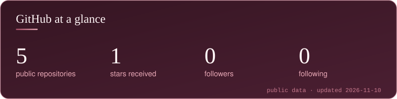
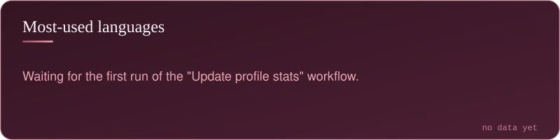
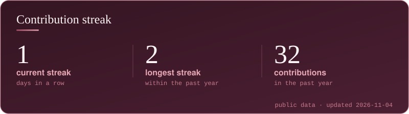
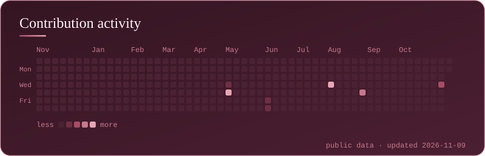

<div align="center">
  
</div>

<p align="center">
  <a href="#about">About</a> &nbsp;·&nbsp;
  <a href="#featured-project">Featured project</a> &nbsp;·&nbsp;
  <a href="#tech-stack">Tech stack</a> &nbsp;·&nbsp;
  <a href="#github-analytics">Analytics</a> &nbsp;·&nbsp;
  <a href="#connect">Connect</a>
</p>

## About

```text
sandesh@kathmandu:~$ whoami
Sandesh Thapa

sandesh@kathmandu:~$ cat about.txt
I like understanding how systems are
built, how they break, and how to
keep them safe. I work across
cybersecurity, networking and web
development, and enjoy turning ideas
into practical, working tools.

sandesh@kathmandu:~$ ls interests/
cybersecurity-and-ethical-hacking/
network-security-and-infrastructure/
full-stack-web-development/
linux-and-system-administration/
self-hosting-and-virtualization/
practical-technical-solutions/

sandesh@kathmandu:~$ echo $STATUS
learning, building, documenting
```


## Featured project

<a href="https://github.com/sandeshig/arp_spoofing">
  
</a>

**ARP Monitor** is a Python desktop application that passively watches ARP traffic on a local network, flags spoofing in real time, and shows everything on a dashboard. It is a defensive tool: it only listens to traffic already on the wire and never sends spoofed packets.

- **Live capture and detection:** ARP packets are captured on a background thread, and the detector flags MAC address changes, duplicate IP claims, fake-gateway impersonation, gratuitous ARP floods and broadcast storms.
- **Network discovery and inventory:** finds the gateway, subnet and active devices, with an offline vendor lookup and an authorized-device whitelist.
- **Alerts and persistence:** severity-based alerts (info, warning, critical), SQLite storage, and logging to TXT, CSV, JSON and SQLite at once.
- **Reports and visuals:** PDF, CSV and TXT reports, plus charts and a network topology diagram that highlights suspicious nodes.
- **Safe demo mode:** a one-click, offline scenario that feeds synthetic packets straight into the detector. Nothing is transmitted and no admin rights are needed.

**Built with:** Python · Scapy · Tkinter · SQLite

<p>
  <a href="https://github.com/sandeshig/arp_spoofing"><b>View the repository</b></a> &nbsp;·&nbsp;
  <a href="https://github.com/sandeshig/arp_spoofing/blob/main/user_manual.pdf">User manual (PDF)</a>
</p>

## More repositories

<table>
  <tr>
    <td width="50%" valign="top">
      <a href="https://github.com/sandeshig/EthicsAssignment">
        
      </a>
      <br>
      An ethics assignment published as a PowerPoint deck with a PDF copy.
    </td>
    <td width="50%" valign="top">
      <a href="https://github.com/sandeshig/sandeshig.github.io">
        
      </a>
      <br>
      GitHub Pages repository configured with a custom domain.
    </td>
  </tr>
</table>


## Tech stack

**Established:** used in my repositories and projects

<p>
  
  
  
  
  
  
  
  
  
</p>
<p>
  
  
  
  
  
  
  
  
</p>

**Learning and practising:** security tooling and virtualization I am building experience with

<p>
  
  
  
  
  
  
  
</p>

## GitHub analytics

<p align="center">
  
  
  
  
</p>

<!--
  Optional profile-view counter. Counts real visits from the moment it first loads.
  Remove the comment markers to enable it:
  
-->


## Currently exploring

<table>
  <tr>
    <td width="33%" align="center"><b>Ethical hacking</b></td>
    <td width="33%" align="center"><b>Network security</b></td>
    <td width="33%" align="center"><b>Linux administration</b></td>
  </tr>
  <tr>
    <td align="center"><b>Infrastructure security</b></td>
    <td align="center"><b>Secure web development</b></td>
    <td align="center"><b>Self-hosted systems</b></td>
  </tr>
</table>

## Connect

<p align="center">
  <a href="https://github.com/sandeshig"></a>
  <a href="https://www.linkedin.com/in/sandeshthapa001/"></a>
  <a href="https://sandeshthapa.name.np"></a>
</p>

<div align="center">
  
</div>
# sandeshig
# sandeshig
